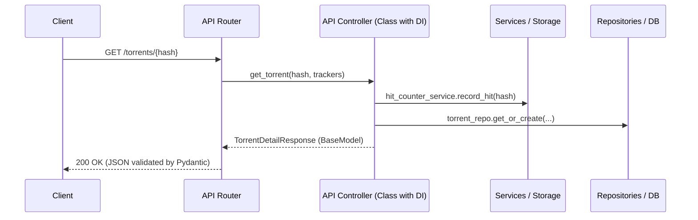
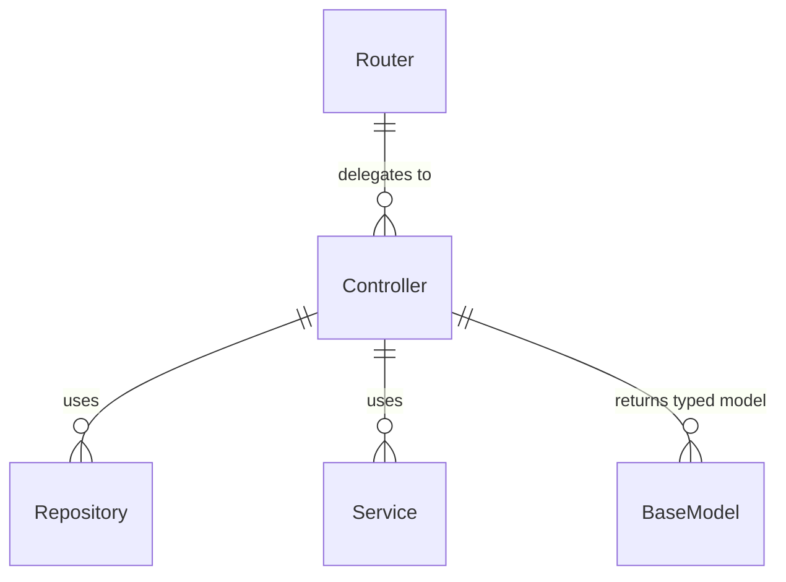

# API Controllers Architecture & Structured Response Models Refactoring

**Approved**: 2026-11-08 - user: "yes"

> Build this with **tlc-implement**. Every criterion becomes a check with a proof; nothing under the open questions is settled while building.

## Problem

Currently, FastAPI route handlers in `torrent_stats/api/routers/` contain both HTTP protocol handling (routing, parameters, headers) and heavy business logic, directly instantiating repositories and services. Additionally, responses are constructed as raw runtime dictionaries (`dict`) rather than typed Pydantic `BaseModel` schemas, making API contracts less robust and harder to introspect automatically in FastAPI documentation. Furthermore, the architectural layering and design decisions of the project are not centrally documented.

When this refactoring ships, business logic is centralized into dedicated controller classes (`TorrentController`, `TaskClaimController`, `TorrentUploadController`, `TrackerStatsController`) injected with repositories and services via `__init__`, API responses are strictly typed via Pydantic `BaseModel` models, and project architecture is documented in `docs/architecture.md`.

## Shape

This refactors the API service (`torrent_stats/api/`) into a clean 3-tier structure: Routers (thin HTTP endpoints) -> Controllers (action-specific classes with dependency injection) -> Services & Repositories (persistence & domain logic).

1. Client request -> `API Router` (exists / refactored) - handles path/query parameters, auth dependencies, and delegates to Controller.
2. `API Controller` (`torrent_stats/api/controllers/`) (new) - class with `__init__` receiving repositories (`TorrentMetadataRepository`, `TaskRepository`, `WorkerKeyRepository`) and services (`HitCounterService`, `StorageManager`), executing business logic and returning typed Pydantic models.
3. FastAPI Response -> validated and serialized via Pydantic `BaseModel` classes (new).

**Changes underneath**

| Front | What changes |
| --- | --- |
| domain / api | New `torrent_stats/api/controllers/` module, new Pydantic response models in `torrent_stats/api/schemas.py`, refactored route handlers in `torrent_stats/api/routers/`, and `docs/architecture.md`. |
| stored data | None (database schema and repositories remain unchanged). |
| readers | HTTP API clients and remote Worker services. |

New: `controllers/` module, Pydantic response models, `docs/architecture.md`. One-way constraints: Controller dependency injection pattern (door 1).

## Surface

| Route | In | Out | Status | Who |
| --- | --- | --- | --- | --- |
| `GET /torrents/:hash` | `hash` (path), `trackers` (query optional) | `TorrentDetailResponse` schema | `200 OK`, `422 Unprocessable Entity` | Anyone |
| `POST /worker/tasks/claim` | Header `X-Worker-Key` | `TaskClaimResponse` schema (or None) | `200 OK`, `204 No Content`, `401 Unauthorized` | Remote Workers |
| `POST /worker/torrents` | Header `X-Worker-Key`, raw `.torrent` file & metadata | `ActionSuccessResponse` schema | `201 Created`, `400 Bad Request`, `401 Unauthorized` | Remote Workers |
| `POST /worker/torrents/:hash/stats` | Header `X-Worker-Key`, tracker seed/peer counts | `ActionSuccessResponse` schema | `200 OK`, `400 Bad Request`, `401 Unauthorized` | Remote Workers |

## Landing

| One-way door | Literal shape | Alternative rejected |
| --- | --- | --- |
| 1. Controller Class with Dependency Injection via `__init__` | Classes with explicit `__init__(torrent_repo, task_repo, worker_key_repo, hit_counter, storage_manager)` instantiated as router dependencies or singletons | Functions with global repository instances or mixin inheritance (rejected due to tight coupling and poor testability) |

- Nothing else in this change is hard to reverse

## Criteria

### S1: Controller Module & Dependency Injection (P1)

As a developer, I want API business logic centralized in dedicated controller classes injected with repositories and services so that handlers are thin and testable.

**Acceptance Criteria**

1. WHEN API routers receive requests THEN they SHALL delegate action handling to dedicated controller classes (`TorrentController`, `TaskClaimController`, `TorrentUploadController`, `TrackerStatsController`).
2. WHEN controllers are instantiated THEN their `__init__` SHALL accept required repositories and services (`TorrentMetadataRepository`, `TaskRepository`, `WorkerKeyRepository`, hit counter, storage manager).
3. WHEN unit or integration tests run against API routes THEN all existing tests SHALL pass successfully without regression.

### S2: Structured Pydantic Response Models (P2)

As an API client or developer, I want API endpoints to return structured Pydantic `BaseModel` instances rather than raw runtime dictionaries so responses are strictly typed and documented.

**Acceptance Criteria**

1. WHEN `GET /torrents/:hash` is called THEN the controller/handler SHALL return a typed Pydantic `TorrentDetailResponse` model.
2. WHEN `POST /worker/tasks/claim` claims a task THEN the controller/handler SHALL return a typed Pydantic `TaskClaimResponse` model (or empty on 204).
3. WHEN `POST /worker/torrents` or `POST /worker/torrents/:hash/stats` completes successfully THEN the controller/handler SHALL return a typed Pydantic `ActionSuccessResponse` model.

### S3: Project Architecture Documentation (P3)

As a developer or agent, I want the project architecture documented in `docs/architecture.md` so that the design layers and refactoring decisions are transparent.

**Acceptance Criteria**

1. WHEN project documentation is inspected THEN `docs/architecture.md` SHALL exist and describe the modular architecture (Routers, Controllers, Services, Repositories, Storage, Worker).
2. WHEN refactoring changes are made THEN `docs/architecture.md` SHALL reflect the controller pattern and structured response models.

## Out of scope

| Excluded | Why |
| --- | --- |
| Changing database backend or models | CouchDB models and repository interfaces are out of scope for this architectural refactoring |
| Changing worker CLI implementation | Go worker binary and python CLI commands are unchanged |

## Assumptions

| Assumption | Chosen default | Rationale | Confirmed |
| --- | --- | --- | --- |
| Controller instantiation strategy | Instantiated as FastAPI dependencies or module-level singletons with default repos/services | Allows easy dependency injection overrides in tests while keeping FastAPI usage clean | y |
| Response schema location | `torrent_stats/api/schemas.py` | Keeps data validation and response models organized and separated from routers and controllers | y |

**Open questions:** none - all resolved or logged above.

## Differences from the source

None - the product matches the user requirements.

## Sources

- User prompt and project context - binding - controller pattern, class-based controllers with DI in `__init__`, Pydantic response models, and architecture documentation.
