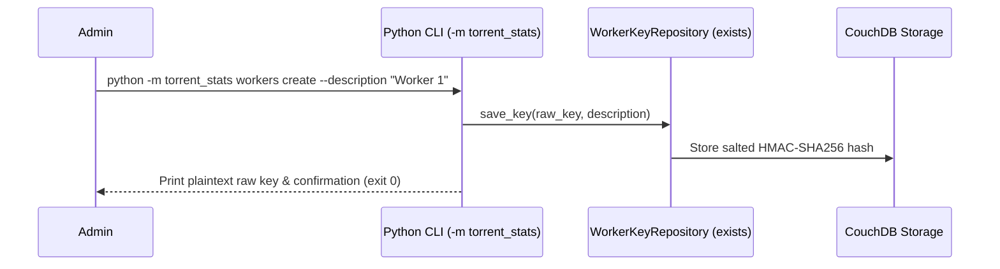
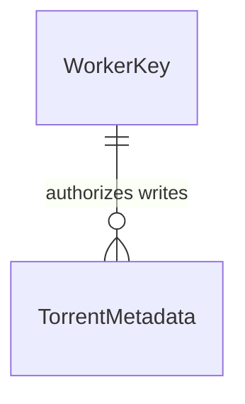

# CLI Worker Key Management

**Approved**: 2026-11-07 - user: "yes"

> Build this with **tlc-implement**. Every criterion becomes a check with a proof; nothing under the open questions is settled while building.

## Problem

Administrators currently have no command-line interface (`python -m torrent_stats`) to manage remote worker authentication keys (create, list, and delete). Because worker key management endpoints are strictly out of scope for the public API for security reasons, administrators need a robust CLI tool to securely issue, inspect, and revoke worker keys against CouchDB.

When this ships, administrators can execute `python -m torrent_stats workers create`, `python -m torrent_stats workers list`, and `python -m torrent_stats workers delete` to manage remote worker access.

## Shape

This reuses the existing `WorkerKeyRepository` and CouchDB client configuration, structured into a standard library `argparse`-based CLI module (`torrent_stats/__main__.py` and submodules).

1. CLI invocation (`python -m torrent_stats`) -> Argument parser -> `WorkerKeyRepository` (exists) -> CouchDB (exists) -> Output to stdout/stderr.

**Changes underneath**

| Front | What changes |
| --- | --- |
| domain | New CLI entrypoint (`torrent_stats/__main__.py`) |
| stored data | None (reuses existing `WorkerKey` schema and repository) |
| readers | Administrators via CLI |

New: nothing (reuses `WorkerKey`).

## Surface

None - nothing consumed outside

## Landing

| One-way door | Literal shape | Alternative rejected |
| --- | --- | --- |
| None | Standard library `argparse` CLI module | Third-party CLI frameworks like Typer or Click (rejected to keep zero extra dependencies) |

- Nothing else in this change is hard to reverse

## Criteria

### S1: CLI Worker Key Management (P1)

As an administrator, I want to manage worker keys via `python -m torrent_stats workers` (create, list, delete).

**Acceptance Criteria**

1. WHEN an administrator runs `python -m torrent_stats workers create --description "Test Worker"` THEN the system SHALL generate a secure raw key, store its salted hash via `WorkerKeyRepository`, print the plaintext raw key to stdout, and exit with code 0.
2. WHEN an administrator runs `python -m torrent_stats workers list` THEN the system SHALL output all registered worker keys with their description, key hash ID, and creation date to stdout, and exit with code 0.
3. WHEN an administrator runs `python -m torrent_stats workers delete <id>` for an existing worker key ID THEN the system SHALL remove the key document from CouchDB, print confirmation to stdout, and exit with code 0.
4. IF an administrator runs `python -m torrent_stats workers delete <nonexistent_id>` THEN the system SHALL print an error message to stderr and exit with code 1.
5. IF the user runs `python -m torrent_stats` without arguments or with invalid arguments THEN the system SHALL print help/usage information and exit with a non-zero exit code.

## Out of scope

| Excluded | Why |
| --- | --- |
| HTTP endpoints for worker key management | Worker key management is restricted strictly to the CLI for security reasons |

## Assumptions

| Assumption | Chosen default | Rationale | Confirmed? |
| --- | --- | --- | --- |
| CLI parsing library | Standard library `argparse` | Zero extra dependencies, robust, built-in | y |

**Open questions:** none - all resolved or logged above.

## Differences from the source

None - the product matches the user requirements.

## Sources

- User prompt and AGENTS.md - binding - worker keys managed exclusively via the project CLI.
