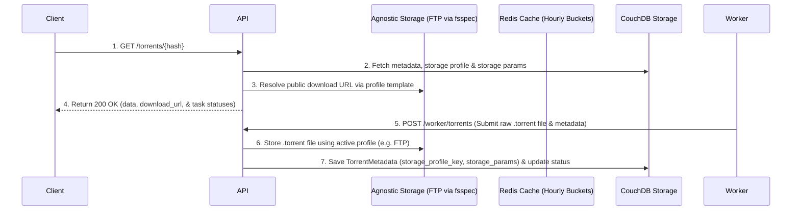
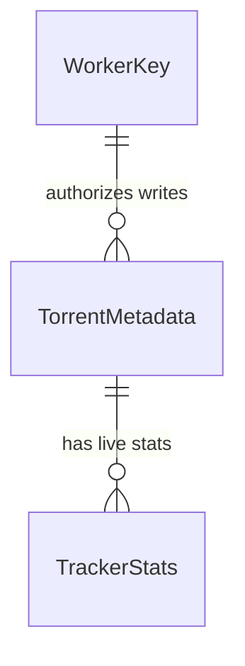

# Core Resolution and Scraping

**Approved**: 2026-11-07 - user: "yes"

> Build this with **tlc-implement**. Every criterion becomes a check with a proof; nothing under the open questions is settled while building.

## Problem

Users want to resolve BitTorrent info hashes into `.torrent` files, detailed file trees, live peer/seed stats across trackers, and task visibility instantly via a 200 OK response, along with direct public download URLs for `.torrent` files stored through an agnostic storage profile system (fsspec-inspired, FTP first) managed via environment settings. Additionally, remote workers need a sophisticated task claiming mechanism (`POST /worker/tasks/claim`) with ACK/leases, failure cooldowns (12h default), stats update cooldowns (6h default), and a 12-hour hourly-bucketed Redis hit-counting strategy synced to CouchDB (`total_hits`, `last_hit_at`).

When this ships, users can query `GET /torrents/:hash` to get current available metadata, public `.torrent` download URLs, and task statuses, while remote workers securely claim tasks and upload `.torrent` files for API-managed agnostic storage.

## Shape

This reuses existing BitTorrent scraping concepts inspired by `betor` (`betorbr/betor-catalog`), structured into an API Service (FastAPI, CouchDB python repository pattern, hourly bucketed hit counters synced to CouchDB, agnostic storage manager with profile templates and `storage_params`, and custom tracker registration) and remote Worker Services communicating via authenticated HTTP API endpoints with task leasing.

1. Client request -> `API` (exists) - records hit in Redis hourly bucket, aggregates 12h sliding window to update `total_hits` and `last_hit_at` in CouchDB (door 1), returns `200 OK` with metadata, public download URLs generated via storage profiles, and task statuses.
2. `Worker` (new) -> `API` (exists) (door 2) - authenticates via salted HMAC-SHA256 worker key (`WorkerKeyRepository`), claims prioritized tasks enforcing failure and update cooldowns.
3. `Worker` (new) -> `API` (exists) (door 3) - submits raw `.torrent` file and metadata; API stores it using active storage profile (FTP / fsspec-inspired) and records profile key & `storage_params`.

**Changes underneath**

| Front | What changes |
| --- | --- |
| domain | New domain for info hash resolution, hourly-bucketed hit tracking, agnostic storage profiles with URL templates, task leasing, and tracker pruning |
| stored data | CouchDB initialized with `TorrentMetadata` (snake_case fields including `storage_profile_key`, `storage_params`, `total_hits`, `last_hit_at`) and hashed `WorkerKey` schemas |
| readers | HTTP API clients and remote Worker services |

New: `TorrentMetadata`, `TrackerStats`, and `WorkerKey` entities. One-way constraints: `info_hash` and `WorkerKey.key_hash` unique (doors 1, 2, & 3).

## Surface

| Route | In | Out | Status | Who |
| --- | --- | --- | --- | --- |
| `GET /torrents/:hash` | `hash` (path), `trackers` (query optional) | metadata, file tree, tracker stats, download_url, task statuses | `200 OK`, `422 Unprocessable Entity` | Anyone |
| `POST /worker/tasks/claim` | Header `X-Worker-Key` | claimed task with lease expiration | `200 OK`, `204 No Content`, `401 Unauthorized` | Remote Workers |
| `POST /worker/torrents` | Header `X-Worker-Key`, raw `.torrent` file & metadata | success confirmation | `201 Created`, `400 Bad Request`, `401 Unauthorized` | Remote Workers |
| `POST /worker/torrents/:hash/stats` | Header `X-Worker-Key`, tracker seed/peer counts, scrape results | success confirmation | `200 OK`, `400 Bad Request`, `401 Unauthorized` | Remote Workers |

## Landing

| One-way door | Literal shape | Alternative rejected |
| --- | --- | --- |
| 1. CouchDB Python Repository Pattern | Pluggable Repository pattern using official `couchdb` library | Hardcoded CouchDB HTTP client calls (rejected due to lack of idiomatic python driver abstractions) |
| 2. Salted HMAC-SHA256 Worker Keys | Hashed worker keys stored in CouchDB, validated via `X-Worker-Key` header with env salt | Plaintext worker keys in database (rejected due to severe security risks) |
| 3. Agnostic Storage Profiles & Templates | Storage profile settings with config & URL template (`https://domain/{file_path}`) | Hardcoded FTP client calls (rejected due to inflexibility for S3 or other storage drivers) |

- Nothing else in this change is hard to reverse

## Criteria

### S1: API Torrent Retrieval, Download URL Generation & Hit Counting (P1)

As a user, I want to query a torrent via `GET /torrents/:hash` and instantly receive metadata, a public download URL for the `.torrent` file, and task statuses.

**Acceptance Criteria**

1. WHEN a client sends `GET /torrents/:hash` THEN the system SHALL return `200 OK` with JSON containing metadata, file list, public `download_url` (constructed dynamically using the storage profile's URL template and stored `storage_params`), Redis peer/seed stats, and task statuses, AND increment the hit count in Redis.
2. WHEN `GET /torrents/:hash` is called for an info hash with no existing record THEN the system SHALL automatically enqueue the scrape task in the background with `pending` status.
3. WHEN `GET /torrents/:hash` includes optional `trackers` query parameters THEN the system SHALL register those custom trackers to be monitored by workers.
4. IF a client sends invalid hash format to `GET /torrents/:hash` THEN the system SHALL return `422 Unprocessable Entity` with `invalid_info_hash`.

### S2: Remote Worker `.torrent` Upload & Agnostic Storage (P2)

As a remote worker, I want to upload raw `.torrent` files to the API so the API handles storage using active profiles and generates correct paths.

**Acceptance Criteria**

1. WHEN a remote worker sends `POST /worker/torrents` with a valid `X-Worker-Key` header, raw `.torrent` file, and metadata THEN the API SHALL upload the file using the active storage profile (FTP via fsspec), record `storage_profile_key` and `storage_params` in CouchDB, update task status to `completed`, and return `201 Created`.
2. IF a request to any `/worker/*` route lacks a valid `X-Worker-Key` header THEN the system SHALL return `401 Unauthorized`.
3. WHEN a remote worker sends `POST /worker/tasks/claim` THEN the system SHALL return prioritized tasks respecting 12h failure cooldowns and 6h stats update cooldowns.
4. WHEN a remote worker sends `POST /worker/torrents/:hash/stats` with scrape results THEN the system SHALL update Redis tracker stats, and IF a tracker accumulates 3 consecutive scrape failures, the system SHALL automatically prune it.

## Out of scope

| Excluded | Why |
| --- | --- |
| HTTP endpoints for worker key management | Worker keys are generated, listed, and revoked exclusively via the project CLI |
| MongoDB driver implementation | CouchDB is the primary initial NoSQL implementation; MongoDB is architected via repository pattern for future work |

## Assumptions

| Assumption | Chosen default | Rationale | Confirmed |
| --- | --- | --- | --- |
| Default storage profile type | FTP (via fsspec) | Easiest initial setup while maintaining agnostic profile interface for S3 | y |
| URL template format | `https://download.asdf.com/{file_path}` | Simple python string formatting using stored storage params | y |

**Open questions:** none - all resolved or logged above.

## Differences from the source

None - the product matches the user requirements.

## Sources

- User prompt and project context - binding - settling CouchDB python library, snake_case fields, env-based storage profiles, storage_params dictionary, and salted HMAC-SHA256 worker keys.
