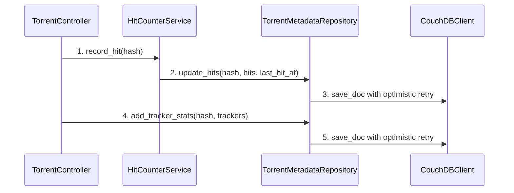
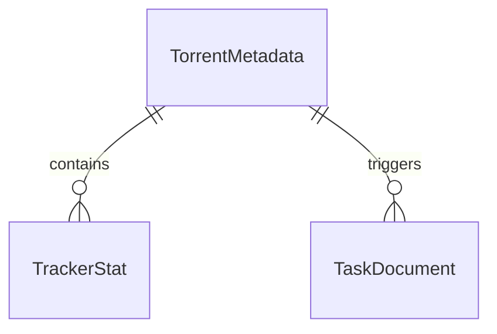

# CouchDB Resource Conflict Resolution

**Approved**: 2026-11-21 - user: "ok"

> Build this with **tlc-implement**. Every criterion becomes a check with a proof; nothing under
> the open questions is settled while building.

## Problem

Concurrent requests and sequential multi-save operations within a single HTTP request cycle (`GET /torrents/{hash}`) cause CouchDB `ResourceConflict` (`Document update conflict`) errors due to MVCC revision mismatches (`_rev`). Users experience HTTP 500 internal server errors when accessing torrent details.

When this ships, `GET /torrents/{hash}` and background workers will execute robust, conflict-free database updates through targeted repository methods and optimistic locking retries, eliminating document update conflicts under concurrency.

## Shape

This reuses `CouchDBClient`, `BaseRepository`, and existing Pydantic models. The rules run in the repository and service layers (`torrent_stats/db/`, `torrent_stats/services/`), fully testable via pytest.

1. API request enters `TorrentController.get_torrent` (exists) -> calls `HitCounterService.record_hit` (exists) -> invokes `TorrentMetadataRepository.update_hits` (new).
2. Controller processes trackers and invokes `TorrentMetadataRepository.add_tracker_stats` (new) or single save via repository.
3. `BaseRepository` / `CouchDBClient` captures `ResourceConflict`, re-fetches latest `_rev`, and retries up to N times (optimistic locking retry, new).

**Changes underneath**

| Front | What changes |
| --- | --- |
| domain | None - domain semantics unchanged |
| stored data | No schema change; CouchDB `_rev` handling enhanced with optimistic retry |
| readers | API consumers and workers experience zero `ResourceConflict` errors |

New: nothing - schema unchanged. One-way constraints: none.

## Surface

| Route | In | Out | Status | Who |
| --- | --- | --- | --- | --- |
| `GET /torrents/{hash}` | `hash: string`, `trackers?: list[str]` | `TorrentDetailResponse` | `200`, `422`, `500` | anyone |

## Landing

| One-way door | Literal shape | Alternative rejected |
| --- | --- | --- |
| Optimistic locking retry in repository save | Decorator or retry loop catching `ResourceConflict`, fetching latest `_rev`, and retrying up to 3 times | Manual handling in every controller/service (rejected: error-prone and repetitive) |
| Specific repository update methods | `update_hits`, `add_tracker_stats` on `TorrentMetadataRepository` | Full document overwrite on every partial change (rejected: causes unnecessary rev conflicts) |

- Nothing else in this change is hard to reverse

## Criteria

### S1: Repository Update Methods and Optimistic Locking Retry (P1)

Robust persistence layer with targeted update methods and automatic retry on CouchDB conflicts.

**Acceptance Criteria**

1. WHEN `TorrentMetadataRepository.update_hits` is called THEN the system SHALL update `total_hits` and `last_hit_at` in CouchDB without overwriting tracker stats or unrelated fields.
2. WHEN `TorrentMetadataRepository.add_tracker_stats` is called THEN the system SHALL append new tracker stats to the torrent document without conflicts.
3. IF a CouchDB `ResourceConflict` occurs during `BaseRepository.save` or repository updates THEN the system SHALL automatically retry the operation up to 3 times with the latest document revision (`_rev`).
4. WHEN `GET /torrents/{hash}` is invoked under concurrent load THEN the system SHALL successfully record hits, update trackers, and return 200 OK without raising `ResourceConflict`.
   - concurrent requests (5 requests simultaneously) → all succeed with 200 OK.

### S2: Task Repository Updates & Save Review (P2)

Targeted update methods for `TaskRepository` and review of repository write operations across controllers.

**Acceptance Criteria**

1. WHEN `TaskRepository.save` is called with a `TaskDocument` update THEN the system SHALL persist the updated status, `lease_expires_at`, and `last_attempt_at` fields in CouchDB successfully.
2. WHEN worker controllers (`claim_task`, `fail_task`, `submit_tracker_stats`, etc.) persist task or torrent state THEN the system SHALL execute repository saves via `CouchDBClient` with automatic `ResourceConflict` retry.

## Out of scope

| Excluded | Why |
| --- | --- |
| Migration to a relational database | CouchDB is the project's chosen datastore |
| Redis hit counter architecture | Redis correctly handles high-throughput incrementing |

## Assumptions

| Assumption | Chosen default | Rationale | Confirmed? |
| --- | --- | --- | --- |
| Max retry attempts for optimistic locking | 3 attempts with short backoff | Balances resilience and request latency | n |

**Open questions:** none - all resolved or logged above.

## Differences from the source

None - no visual binding source; derived from investigation report on CouchDB `ResourceConflict`.

## Sources

- `docs/investigations/couchdb-resource-conflict.md` - binding - investigation findings and bug analysis
