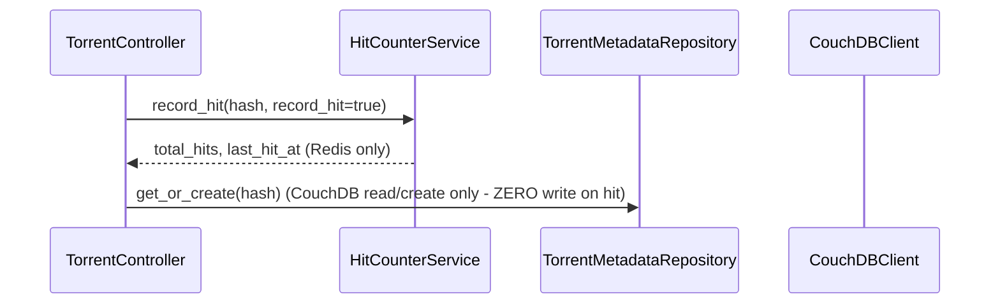

# Hit Count Architecture Refactoring (Decoupled Redis Hit Counter & Priority Worker Claim)

**Status**: Draft / Awaiting Approval

## Problem

Under concurrent load, every `GET /torrents/{hash}` request invokes `HitCounterService.record_hit`, which immediately updates `total_hits` and `last_hit_at` in the CouchDB `TorrentMetadata` document. Even with optimistic locking retries in `CouchDBClient`, multiple concurrent requests for the same torrent info hash cause heavy MVCC revision contention (`_rev` mismatch), resulting in frequent `ResourceConflict` (`Document update conflict`) errors and HTTP 500 responses.

Additionally, worker task claiming needs to prioritize tasks (first `scrape_torrent`, then `scrape_stats`) ordered from the most hit torrents to the least hit torrents based on Redis hit metrics.

## Solution Architecture

1. **Decoupled Redis Hit Counter & Last Hit Key**:
   - `HitCounterService.record_hit` increments the current hour bucket in Redis (12h TTL), aggregates the 12-hour sliding window total hits, and records/updates a dedicated last hit timestamp key in Redis (`torrent:last_hit:{info_hash}`).
   - Query parameter support: `GET /torrents/{hash}?record_hit=true` (default `true`). If `record_hit=false`, the hit counter is not incremented, but current hit stats and last hit timestamp are retrieved from Redis without modifying counters.
2. **Zero CouchDB Writes on Torrent Retrieval**:
   - When `GET /torrents/{hash}` is requested, `TorrentMetadataRepository.get_or_create` (or `get`) performs **zero write operations on CouchDB**. CouchDB `TorrentMetadata` is read/created only on initial torrent creation or when tracker/task state changes. All hit metrics and last hit timestamps are served from Redis.
3. **Hit-Prioritized Worker Task Claiming**:
   - When workers call `POST /worker/tasks/claim`, claimable tasks are sorted and prioritized:
     1. `scrape_torrent` tasks first, ordered by **highest hit count to lowest hit count** (retrieved from Redis).
     2. `scrape_stats` tasks second, ordered by **highest hit count to lowest hit count** (retrieved from Redis).

## Changes

| Component | Change |
| --- | --- |
| `HitCounterService` (`torrent_stats/services/hit_counter.py`) | Add `record_hit: bool = True` parameter, store/retrieve `torrent:last_hit:{info_hash}` in Redis, remove CouchDB writes. |
| API Endpoint / Controller (`torrent_stats/interfaces/api/routers/torrents.py`, `torrent_stats/controllers/torrents.py`) | Add `record_hit` query parameter. Ensure zero CouchDB writes on `GET /torrents/{hash}` for existing torrents. |
| `TaskClaimController` (`torrent_stats/controllers/claim_task.py`) | Integrate `HitCounterService` (or Redis hit lookup) to sort claimable tasks: `scrape_torrent` (highest hits to lowest), then `scrape_stats` (highest hits to lowest). |
| Tests | Update unit, integration, and worker test suites to verify zero CouchDB hit writes and hit-prioritized task claiming. |

## Landing / Trade-offs

| One-way door | Literal shape | Alternative rejected |
| --- | --- | --- |
| Pure Redis hit metrics & priority worker sorting | Hit counts and last hit timestamp in Redis; task claiming sorted by Redis hit sum | Syncing hits to CouchDB on every request (rejected: causes unresolvable `ResourceConflict`) |

## EARS Criteria & Acceptance Criteria

### S1: Decoupled Redis Hit Counter & Zero CouchDB Write (P1)

**Acceptance Criteria**
1. WHEN `GET /torrents/{hash}?record_hit=true` is called THEN the system SHALL increment Redis hourly buckets, update `torrent:last_hit:{info_hash}`, compute 12h total hits, and return 200 OK **without performing any write operation on CouchDB**.
2. WHEN `GET /torrents/{hash}?record_hit=false` is called THEN the system SHALL retrieve current hit stats and last hit timestamp from Redis without incrementing the hit counter or writing to CouchDB.
3. WHEN `GET /torrents/{hash}` is invoked under heavy concurrent load THEN all requests complete with 200 OK without raising CouchDB `ResourceConflict`.

### S2: Hit-Prioritized Worker Task Claiming (P2)

**Acceptance Criteria**
1. WHEN `POST /worker/tasks/claim` runs THEN the system SHALL prioritize claimable tasks such that `scrape_torrent` tasks are claimed first (ordered from highest hit count to lowest hit count), followed by `scrape_stats` tasks (ordered from highest hit count to lowest hit count).

## Assumptions

| Assumption | Chosen default | Rationale | Confirmed? |
| --- | --- | --- | --- |
| Default value of `record_hit` query param | `True` | Standard API behavior records a hit on detail retrieval | Pending approval |

**Open questions:** None.
