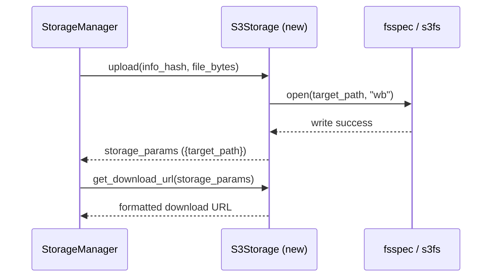
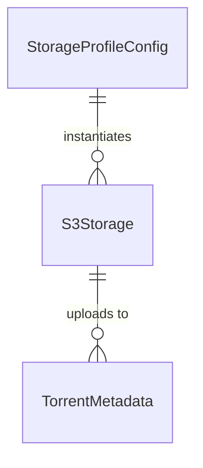

# S3 Storage Support

**Approved**: 2025-02-19 - user: "yes"

> Build this with **tlc-implement**. Every criterion becomes a check with a proof; nothing under
> the open questions is settled while building.

## Problem

The system currently supports local and FTP storage profiles via `fsspec`, but lacks S3 storage profile support. Users who want to store `.torrent` files in AWS S3 or S3-compatible object storage (such as MinIO or LocalStack) cannot configure or use an S3 storage profile, limiting deployment flexibility.

When this ships, users can configure an S3 storage profile (type `s3` or `s3fs`) using environment variables, upload `.torrent` files directly to S3 via `fsspec` (`s3fs`), and generate download URLs using templates.

## Shape

This reuses `BaseStorage`, `StorageManager`, and `fsspec` (`s3fs`) instead of duplicating storage logic. The rules that change storage routing and URL generation run in the storage service layer, which unit tests reach directly.

1. `StorageManager` (exists) -> `S3Storage` (new) - instantiates `fsspec.filesystem("s3", **fs_config)` and uploads torrent file bytes to target path.
2. `S3Storage` (new) -> `fsspec` / `s3fs` (exists) - writes bytes to S3 object storage and returns storage parameters (`target_path`).
3. `S3Storage` (new) -> `get_download_url` - formats download URL via `download_url_template` or raises `ValueError` if missing.

**Changes underneath**

| Front | What changes |
| --- | --- |
| domain | New storage type `"s3"` and `"s3fs"` added to `STORAGE_REGISTRY`. |
| stored data | None - storage parameter schema (`target_path`) is compatible with existing metadata models. |
| readers | `StorageManager.get_download_url` and download endpoints. |

New: `S3Storage` class supporting `s3` and `s3fs` profile types. One-way constraints: none.

## Surface

None - no new API routes or HTTP endpoint signatures change; existing storage profile and upload endpoints now support `"s3"` storage type.

## Landing

| One-way door | Literal shape | Alternative rejected |
| --- | --- | --- |
| S3 `fsspec` integration | `fsspec.filesystem("s3", **fs_config)` | Writing custom boto3 client wrapper (rejected: bypasses `fsspec` abstraction and uniformity with local/FTP). |

- Nothing else in this change is hard to reverse

## Criteria

### S1: S3 Storage Upload and Download URL Generation (P1)

Support uploading `.torrent` files to S3 via `fsspec` (`s3fs`) and resolving download URLs.

**Acceptance Criteria**

1. WHEN `StorageManager` invokes upload with an active S3 profile THEN `S3Storage` SHALL initialize `fsspec.filesystem("s3")` with profile configuration (excluding `download_url_template` and `target_path_template`), write the `.torrent` file to the target path (defaulting to `.torrents/{info_hash}.torrent`), and return `{"target_path": target_path}`.
2. WHEN `S3Storage.get_download_url` is called with valid storage params and `download_url_template` defined in profile config THEN it SHALL return the formatted download URL.
3. IF `S3Storage.get_download_url` is called when `download_url_template` is missing THEN it SHALL raise a `ValueError`.
4. WHEN `STORAGE_REGISTRY` maps `"s3"` or `"s3fs"` THEN it SHALL resolve to `S3Storage`.

## Out of scope

| Excluded | Why |
| --- | --- |
| Direct presigned S3 URL generation without template | Out of scope; template-based URL generation aligns with existing FTP and local storage design. |

## Assumptions

| Assumption | Chosen default | Rationale | Confirmed? |
| --- | --- | --- | --- |
| Default target path template for S3 | `.torrents/{info_hash}.torrent` | Consistent with local and FTP storage profiles. | y |

**Open questions:** none - all resolved or logged above.

## Differences from the source

None - no external design source.

## Sources

- User request - binding - implement S3 storage type using `fsspec` like FTP and local storage, and update documentation.
