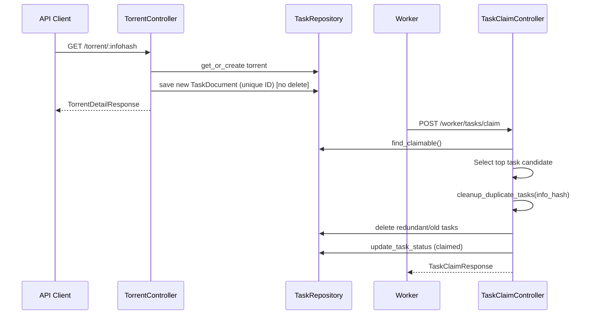
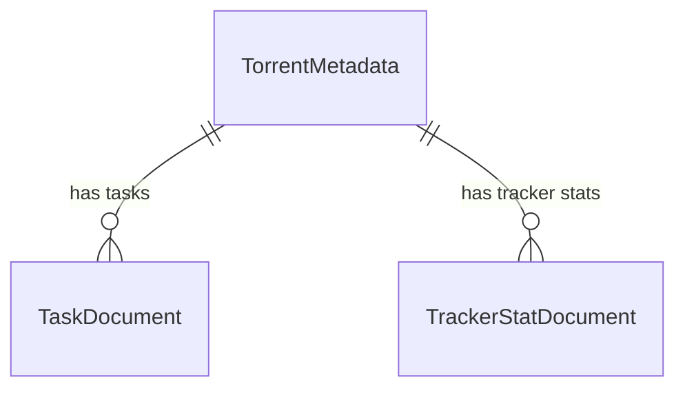

# Task Cleanup on Claim & Remove Torrent Delete Contention

> Build this with **tlc-implement**. Every criterion becomes a check with a proof; nothing under
> the open questions is settled while building.

## Problem

Concurrent requests to the `/torrent/:infohash` endpoint attempt to delete and recreate task documents simultaneously, leading to CouchDB `ResourceConflict` errors (`409 Conflict`). Furthermore, task ID generation was deterministic per info_hash/task_type/tracker_url, forcing delete operations to avoid document ID collisions.

When this ships, `/torrent/:infohash` will save new tasks without deleting existing ones, eliminating write contention on the endpoint. Duplicate task documents will be cleaned up asynchronously by workers during task claiming.

## Shape

This reuses existing `TaskRepository`, `TorrentMetadataRepository`, and `TaskClaimController`, modifying `TorrentController` to remove task deletes, updating `TaskDocument` ID generation to be unique, and introducing a cleanup method in `TaskClaimController`. Rules run in Python controllers and repositories tested via pytest.

1. GET `/torrent/:infohash` -> `TorrentController` (exists) - records hit, gets or creates torrent, evaluates tasks and tracker stats, saves new `TaskDocument` (with unique generated IDs) without deleting existing tasks.
2. POST `/worker/tasks/claim` -> `TaskClaimController` (exists) - finds claimable tasks, prioritizes and selects top task candidate.
3. `TaskClaimController` (exists) - calls `cleanup_duplicate_tasks(info_hash)` (new method) to remove older/redundant/completed/failed tasks for that info_hash.
4. `TaskClaimController` (exists) updates status to `claimed` and returns task response.

**Changes underneath**

| Front | What changes |
| --- | --- |
| domain | Task document IDs are now unique (e.g. using uuid4 or timestamp/random suffix) instead of deterministic per info_hash/task_type, allowing multiple task documents to coexist. |
| stored data | Task documents may temporarily duplicate until cleaned up during task claim. |
| readers | API endpoint `/torrent/:infohash` no longer deletes task documents. |

New: nothing - schema structure remains identical, only TaskDocument ID generation and repository handling change. One-way constraints: TaskDocument IDs are unique UUIDs/random strings (door 1).

## Surface

| Route | In | Out | Status | Who |
| --- | --- | --- | --- | --- |
| `GET /torrent/{info_hash}` | `info_hash`, optional query params | `TorrentDetailResponse` | `200`, `422` | Anyone |
| `POST /worker/tasks/claim` | `X-Worker-Key` header | `TaskClaimResponse` | `200`, `204`, `401` | Worker with valid key |

## Landing

| One-way door | Literal shape | Alternative rejected |
| --- | --- | --- |
| 1. Unique TaskDocument IDs | `TaskDocument` generates unique IDs (e.g., UUID-based or timestamp-random suffix) allowing multiple task documents per info_hash/task_type/tracker_url to coexist in CouchDB. | Deterministic IDs (`task-{info_hash}-{task_type}`) which require delete operations before save. |

- Nothing else in this change is hard to reverse

## Criteria

### S1: Task Cleanup on Claim and Non-Destructive Torrent Controller (P1)

Tasks are created without deleting existing ones during torrent inspection, and duplicate tasks are cleaned up when a worker claims a task for an info_hash.

**Acceptance Criteria**

1. WHEN `GET /torrent/{info_hash}` is called multiple times concurrently or sequentially THEN the system SHALL save new task documents without issuing task delete operations, avoiding `ResourceConflict` errors.
2. WHEN `TaskDocument` is created THEN its ID SHALL be unique (such as UUID-based) so multiple task documents for the same `info_hash` and `task_type` can be saved without ID collision.
3. WHEN a worker calls `POST /worker/tasks/claim` and claims a task THEN the system SHALL invoke the cleanup method `cleanup_duplicate_tasks(info_hash)` in `TaskClaimController` to remove redundant/older task documents associated with that `info_hash`.
4. IF `cleanup_duplicate_tasks(info_hash)` executes THEN it SHALL retain active/claimed/pending tasks while cleaning up stale or completed duplicate tasks for that info_hash.

## Out of scope

| Excluded | Why |
| --- | --- |
| Changing worker execution protocol | Worker tasks contract and endpoint signature remain unchanged. |

## Assumptions

| Assumption | Chosen default | Rationale | Confirmed? |
| --- | --- | --- | --- |
| Task ID generation format | Use `uuid4()` or unique suffix in `TaskDocument.set_id` | Ensures absolute uniqueness without collision | y |

**Open questions:** none - all resolved or logged above.

## Differences from the source

None - no external design source provided.

## Sources

- User request & specification - binding - Removals of delete in torrent controller, unique task ID generation, moving cleanup logic to task claim controller.
