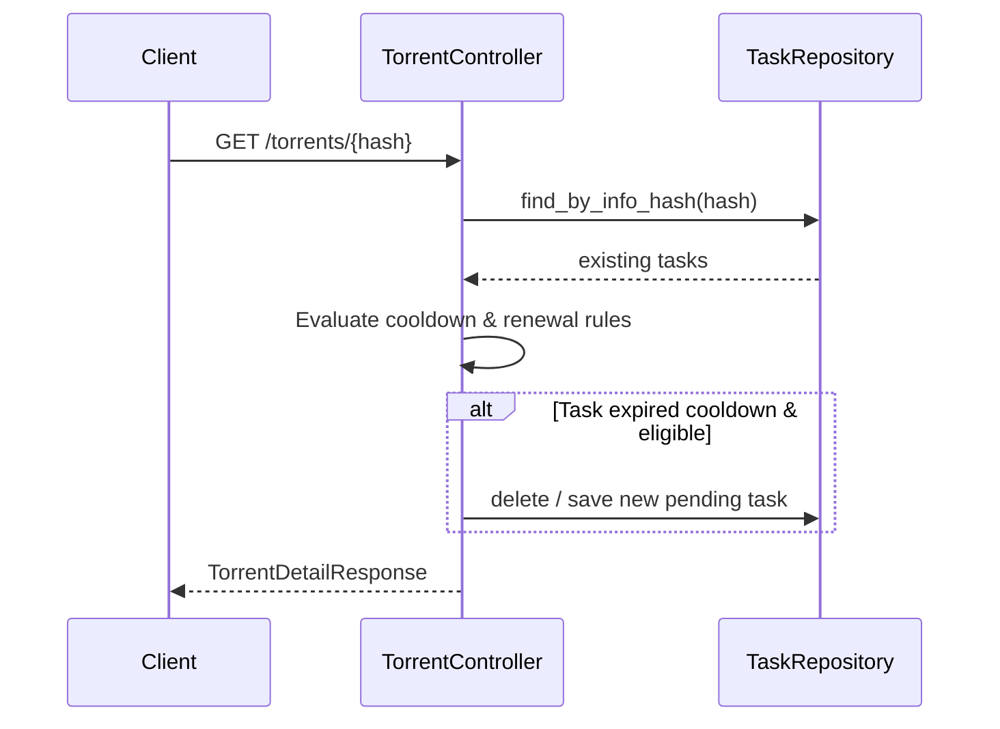
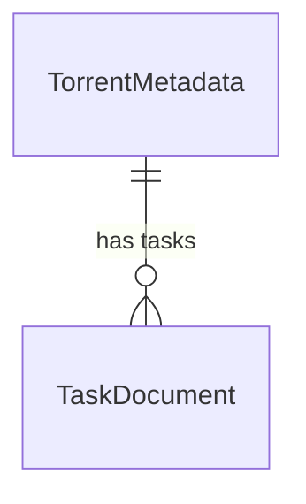

# Task Recreation and Cooldown Renewal

**Approved**: 2026-11-22 - user: "ok"

> Build this with **tlc-implement**. Every criterion becomes a check with a proof; nothing under
> the open questions is settled while building.

## Problem

Currently, once a `scrape_torrent` or `scrape_stats` task is created for a torrent, its existence prevents any future tasks from being created regardless of its status (`completed` or `failed`), and failed tasks are never retried or recreated once their cooldown has elapsed. Users and system operators pay the cost of stale or permanently failed torrent task states without automatic retries or periodic stats refresh.

When this ships, failed `scrape_torrent` tasks are automatically renewed after `WORKER_SCRAPE_TORRENT_FAILURE_COOLDOWN_SECONDS` (default 1 hour), `scrape_stats` tasks (both completed and failed) are refreshed/retried periodically after `WORKER_STATS_COOLDOWN_SECONDS` (default 30 minutes), while successfully completed `scrape_torrent` tasks remain terminal and are not renewed.

## Shape

This reuses `TorrentController`, `TaskRepository`, and `worker_settings` instead of duplicating logic, executing task renewal evaluation within the API torrent controller layer (`TorrentController.get_torrent`) when resolving torrents.

1. `GET /torrents/{hash}` -> `TorrentController` (exists) - fetches existing tasks via `TaskRepository.find_by_info_hash(hash)`.
2. `TorrentController` (exists) - evaluates task cooldown and renewal logic:
   - For `scrape_torrent`: if failed and elapsed time since `last_attempt_at` exceeds `worker_scrape_torrent_failure_cooldown_seconds`, removes old task and creates new `pending` task. If completed, does nothing.
   - For `scrape_stats`: if completed or failed, and elapsed time since `tracker_updated_at` (or `last_attempt_at` / `updated_at`) exceeds `worker_stats_cooldown_seconds`, removes old task and creates new `pending` task.
3. `TaskRepository` (exists) - persists deleted/new tasks.
4. out: `TorrentDetailResponse` (exists) with updated active tasks.

**Changes underneath**

| Front | What changes |
| --- | --- |
| domain | Task lifecycle semantics: tasks that fail or complete stats can now be renewed upon request after cooldown expiration. |
| stored data | Old completed/failed task documents meeting renewal criteria are replaced with new `pending` task documents. |
| readers | `GET /torrents/{hash}` and `POST /worker/tasks/claim` see newly created `pending` tasks. |

New: nothing - read only (tasks are created/deleted via existing model structures). One-way constraints: none.

## Surface

| Route | In | Out | Status | Who |
| --- | --- | --- | --- | --- |
| `GET /torrents/{hash}` | `hash` (path), `trackers` (query, optional) | `TorrentDetailResponse` | `200`, `404` | Anyone |

## Landing

| One-way door | Literal shape | Alternative rejected |
| --- | --- | --- |
| None - task renewal relies on existing CouchDB document deletion and creation primitives without schema changes or new tables/databases. | N/A | N/A |

- Nothing else in this change is hard to reverse

## Criteria

### S1: Task Renewal and Recreation After Cooldown (P1)

Failed and stale tasks are automatically renewed and recreated as pending after cooldown.

**Acceptance Criteria**

1. WHEN a `scrape_torrent` task is in `failed` status and the elapsed time since `last_attempt_at` exceeds `worker_scrape_torrent_failure_cooldown_seconds`, THEN `GET /torrents/{hash}` SHALL remove the old failed task and create a new `scrape_torrent` task with `status="pending"`.
   - Elapsed time < torrent failure cooldown → old task retained; elapsed time >= torrent failure cooldown → old task replaced by new `pending` task.
2. WHEN a `scrape_torrent` task is in `completed` status, THEN `GET /torrents/{hash}` SHALL NOT renew or recreate it, regardless of elapsed time.
   - Completed `scrape_torrent` task present → no new `scrape_torrent` task created.
3. WHEN a `scrape_stats` task is in `completed` or `failed` status and the elapsed time since `tracker_updated_at` (or `last_attempt_at` / `updated_at`) exceeds `worker_stats_cooldown_seconds`, THEN `GET /torrents/{hash}` SHALL remove the old task and create a new `scrape_stats` task for that tracker with `status="pending"`.
   - Elapsed time < stats cooldown → old task retained; elapsed time >= stats cooldown → old task replaced by new `pending` task.
4. WHILE a task is in `pending`, `claimed`, or `scraping` status, THEN `GET /torrents/{hash}` SHALL NOT renew or recreate it.

## Out of scope

| Excluded | Why |
| --- | --- |
| Background cron/worker daemon for proactive task renewal | Task renewal triggered on-demand via `GET /torrents/{hash}` matches existing request-driven architecture |

## Assumptions

| Assumption | Chosen default | Rationale | Confirmed? |
| --- | --- | --- | --- |
| Deleting old task document and creating a new one preserves clean task IDs and history | Delete old task and create new `TaskDocument` | Avoids complex in-place state mutation issues and maintains clear task provenance | y |

**Open questions:** none - all resolved or logged above.

## Differences from the source

None - no binding UI source for this backend task lifecycle feature.

## Sources

- `@docs/investigations/task-recreation-after-cooldown.md` - binding - investigation report on task recreation issues.
