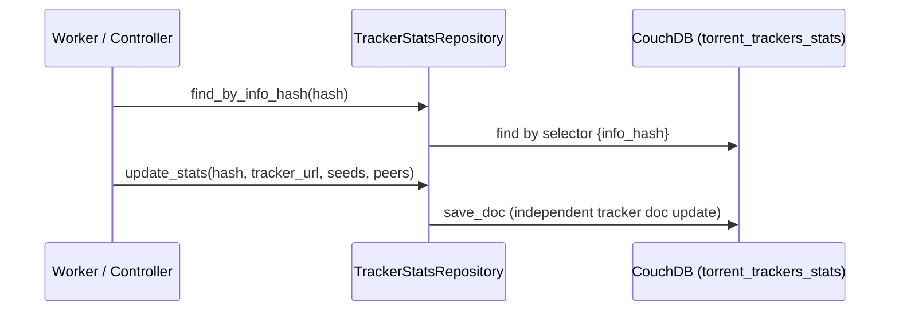

# Tracker Stats Repository & Decoupled Storage Architecture

**Approved**: 2026-11-21 - user: "crie uma nova branch, realize a implementacao e abra o pr. so atualize o padrao do nome da base, use torrent_trackers_stats"

## Problem

Currently, `TrackerStat` items are stored as an embedded list (`tracker_stats: list[TrackerStat]`) inside the `TorrentMetadata` CouchDB document. Whenever tracker stats are updated, submitted by workers, or pruned due to consecutive failures, the entire `TorrentMetadata` document must be updated and saved. Under concurrent API requests and worker submissions, this causes heavy document write contention and `ResourceConflict` (`Document update conflict`) errors.

## Solution Architecture

1. **Dedicated CouchDB Database (`torrent_trackers_stats`)**:
   - Create a separate CouchDB database for tracker statistics (configured via `couchdb_trackers_db_name`).
   - Each tracker stat document represents a specific tracker URL for a given torrent (`info_hash`), similar to how `TaskDocument` is managed in `torrent_stats_tasks`.
2. **`TrackerStatsRepository`**:
   - Implement `TrackerStatsRepository` providing:
     - `find_by_info_hash(info_hash: str) -> list[TrackerStatDocument]` (queried via CouchDB selectors).
     - `get_or_create` / `get_or_update` for tracking new or existing trackers.
     - `update_stats(info_hash: str, tracker_url: str, seeds: int, peers: int)` for successful scrapes.
     - Failure tracking and consecutive failures update (incrementing `consecutive_failures`, pruning or resetting upon success).
3. **Decoupled Torrent Metadata**:
   - Remove the embedded `tracker_stats` list from `TorrentMetadata`.
   - Controllers and services query `TrackerStatsRepository` independently, avoiding write contention on the main `TorrentMetadata` document.

## Changes

| Component | Change |
| --- | --- |
| Settings (`torrent_stats/settings.py`) | Add `couchdb_trackers_db_name: str = "torrent_trackers_stats"`. |
| Models (`torrent_stats/db/models.py`) | Remove `tracker_stats` from `TorrentMetadata`. Introduce `TrackerStatDocument` model with `info_hash`, `tracker_url`, `seeds`, `peers`, `updated_at`, `consecutive_failures`. |
| Repository (`torrent_stats/db/repository.py`) | Implement `TrackerStatsRepository` with selector-based querying and update operations. |
| Controllers & Routers (`torrent_stats/controllers/`, `torrent_stats/interfaces/api/routers/`) | Refactor `TorrentController`, `TaskClaimController`, `TrackerStatsController` to use `TrackerStatsRepository`. |

## Landing / Trade-offs

| One-way door | Literal shape | Alternative rejected |
| --- | --- | --- |
| Separate CouchDB database for tracker stats | Independent documents per tracker keyed/queried by `info_hash` | Embedded list inside `TorrentMetadata` document (rejected: causes CouchDB `ResourceConflict` on every stats submission) |

## EARS Criteria & Acceptance Criteria

### S1: Tracker Stats Database & Repository (P1)

**Acceptance Criteria**
1. WHEN `TrackerStatsRepository.find_by_info_hash` is called THEN the system SHALL return all tracker stat documents associated with the given info hash via CouchDB selector search.
2. WHEN `TrackerStatsRepository.update_stats` is called with `info_hash`, `tracker_url`, `seeds`, and `peers` THEN the system SHALL persist the updated stats, set `updated_at`, reset `consecutive_failures` to 0, and save without modifying the torrent metadata document.
3. WHEN a tracker scrape fails THEN the system SHALL update the tracker stat document by incrementing `consecutive_failures` and updating failure timestamps.
4. WHEN submitting tracker stats or querying torrent details under concurrent load THEN the system SHALL experience zero CouchDB `ResourceConflict` errors on tracker updates.

## Out of scope

- Changes to task repository or hit counter architecture

## Assumptions

| Assumption | Chosen default | Rationale | Confirmed? |
| --- | --- | --- | --- |
| CouchDB database name for trackers | `torrent_trackers_stats` | Aligns with user instruction and existing `torrent_stats_tasks` convention | y |

**Open questions:** None.
