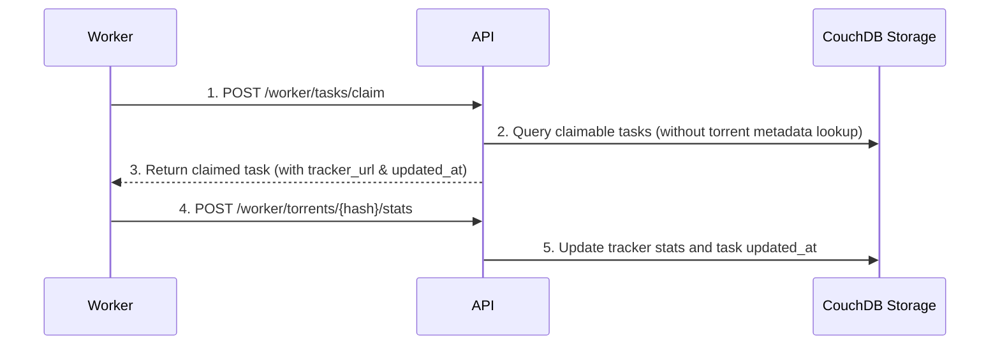
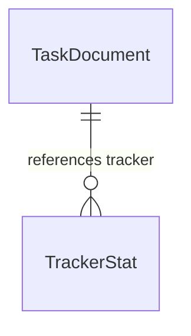

# Tracker Stats Task Optimization

**Approved**: 2026-11-07 - user: "aprovo o plan"

> Build this with **tlc-implement**. Every criterion becomes a check with a proof; nothing under the open questions is settled while building.

## Problem

When `scrape_stats` tasks are created for custom trackers, `seeds`, `peers`, and `updated_at` previously defaulted to active timestamps, triggering the 6h update cooldown prematurely and causing initial scrape tasks to be skipped. Additionally, `claim_task` required extra database queries to fetch torrent metadata to check tracker update times, and worker claim responses lacked direct context (`tracker_url`, `updated_at`), forcing workers to make extra API calls.

When this ships, unupdated tracker stats have `seeds`, `peers`, and `updated_at` as `null`, task claims process them immediately ignoring cooldowns without querying torrent metadata, and both `GET /torrents/:hash` and `POST /worker/tasks/claim` return `tracker_url` and `updated_at` directly in task payloads.

## Shape

This reuses existing `TaskDocument`, `TrackerStat`, and repository structures, denormalizing tracker stats context onto `TaskDocument` and updating API contracts.

1. Client request -> `API` (exists) - sets new tracker stats with `seeds: null`, `peers: null`, `updated_at: null`, and enqueues `TaskDocument` with `tracker_url` and `tracker_updated_at: null`.
2. Worker -> `POST /worker/tasks/claim` (exists) - evaluates cooldown directly from `TaskDocument` fields (`tracker_updated_at`) without querying torrent metadata (door 1), returning `tracker_url` and `updated_at` in response.
3. Worker -> `POST /worker/torrents/{hash}/stats` (exists) - updates tracker stats and task `updated_at`.

**Changes underneath**

| Front | What changes |
| --- | --- |
| domain | `TrackerStat` and `TaskDocument` models updated to allow `null` for `seeds`, `peers`, and `updated_at` when unupdated. `TaskDocument` denormalizes `tracker_updated_at`. |
| stored data | Migrate existing documents on read / default to null. |
| readers | API clients (`GET /torrents/:hash`) and remote workers (`POST /worker/tasks/claim`). |

New: nothing (modifies existing fields).

## Surface

| Route | In | Out | Status | Who |
| --- | --- | --- | --- | --- |
| `GET /torrents/:hash` | `hash` (path), `trackers` (query) | metadata, tracker stats (`updated_at` null if unupdated), tasks (`tracker_url`, `updated_at`) | `200`, `422` | Anyone |
| `POST /worker/tasks/claim` | Header `X-Worker-Key` | claimed task (`task_id`, `info_hash`, `task_type`, `tracker_url`, `updated_at`, `lease_expires_at`) | `200`, `204`, `401` | Remote Workers |

## Landing

| One-way door | Literal shape | Alternative rejected |
| --- | --- | --- |
| None | Denormalized task attributes and nullable tracker stats | Extra metadata lookups during task claiming (rejected due to query overhead and architectural coupling) |

- Nothing else in this change is hard to reverse

## Criteria

### S1: Tracker Stats Task Optimization & Nullability (P1)

As a user and worker, I want unupdated tracker stats to have null values, initial scrapes to bypass cooldowns without metadata lookups, and task outputs to include tracker details.

**Acceptance Criteria**

1. WHEN `GET /torrents/:hash` registers a new custom tracker THEN the system SHALL set `seeds`, `peers`, and `updated_at` to `null` in `TrackerStat`.
2. WHEN `POST /worker/tasks/claim` evaluates a `scrape_stats` task whose tracker `updated_at` is `null` (or `tracker_updated_at` is `null`) THEN the system SHALL process and claim the task immediately, ignoring the 6h stats update cooldown.
3. WHEN `POST /worker/tasks/claim` returns a claimed task THEN the system SHALL include `tracker_url` (nullable) and `updated_at` (nullable) in the response JSON.
4. WHEN `GET /torrents/:hash` returns task statuses THEN the system SHALL include `tracker_url` (nullable) and `updated_at` (nullable) in each task object in the JSON response.
5. WHILE evaluating stats update cooldowns during task claiming, the system SHALL check `tracker_updated_at` directly on the `TaskDocument` without querying torrent metadata.

## Out of scope

| Excluded | Why |
| --- | --- |
| WebSocket support for task claiming | HTTP polling and leasing via POST /worker/tasks/claim is the binding design |

## Assumptions

| Assumption | Chosen default | Rationale | Confirmed? |
| --- | --- | --- | --- |
| Nullable fields default | `None` in python, `null` in JSON | Standard representation for uninitialized or unupdated metrics | y |

**Open questions:** none - all resolved or logged above.

## Differences from the source

None - the product matches the user requirements.

## Sources

- User prompt - binding - nullability for unupdated stats, cooldown bypass when null, denormalized task fields, and task response payload fields.
- [docs/investigations/scrape-stats-claim.md](../../../docs/investigations/scrape-stats-claim.md) - binding - root cause analysis and correction design for `scrape_stats` task claiming.
