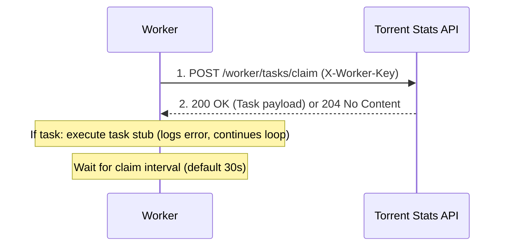
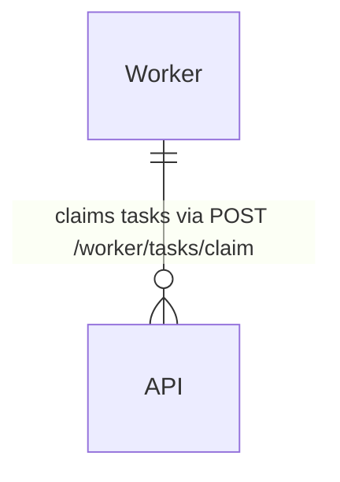

# Worker Initial Implementation

**Approved**: 2026-11-07 - user: "ok"

> Build this with **tlc-implement**. Every criterion becomes a check with a proof; nothing under the open questions is settled while building.

## Problem

Administrators and operators need a remote worker binary in Go (`worker/`) that authenticates against the Torrent Stats API using a worker key and polls the task claim endpoint (`POST /worker/tasks/claim`) at regular intervals. Currently, no worker binary exists to claim and process tasks.

When this ships, operators can run the worker binary with required API URL and Worker Key configurations (provided via terminal arguments or environment variables, with arguments taking precedence) to continuously poll for tasks and handle claim responses, with stubbed task execution logging errors without crashing.

## Shape

This builds upon standard Go library (`net/http`, `os`, `flag`, `log`, `time`) to create a standalone worker executable in `worker/`, communicating exclusively via authenticated HTTP API endpoints (`X-Worker-Key`).

1. Worker binary startup -> parses terminal arguments and environment variables (terminal args taking precedence) -> validates required API URL and Worker Key -> starts polling loop at configured interval (default 30s).
2. Polling loop -> `POST /worker/tasks/claim` endpoint (exists) with `X-Worker-Key` header -> receives task or 204 No Content -> if task received, invokes task execution stub which logs an error without terminating the worker.

**Changes underneath**

| Front | What changes |
| --- | --- |
| domain | New Go worker binary package (`worker/`) |
| stored data | None |
| readers | API task claim endpoint (`POST /worker/tasks/claim`) |

New: Go worker executable with config parsing, HTTP client with `X-Worker-Key`, claim loop, and task stubs. One-way constraints: none.

## Surface

None - consumed outside only by the internal API endpoints.

## Landing

| One-way door | Literal shape | Alternative rejected |
| --- | --- | --- |
| None | Standalone Go binary with standard library flag/env parsing | Third-party CLI/config frameworks like Cobra or Viper (rejected to keep zero external dependencies for initial worker build) |

- Nothing else in this change is hard to reverse

## Criteria

### S1: Worker Configuration & Validation (P1)

As a remote worker operator, I want to configure the worker via command-line arguments or environment variables, with strict validation for mandatory parameters.

**Acceptance Criteria**

1. WHEN the worker is executed with `--api-url <url>` or `API_URL=<url>` and `--worker-key <key>` or `WORKER_KEY=<key>` THEN the worker SHALL successfully validate and use those configurations.
2. WHEN command-line arguments (`--api-url`, `--worker-key`, `--claim-interval`) and environment variables (`API_URL`, `WORKER_KEY`, `CLAIM_INTERVAL`) are both present THEN command-line arguments SHALL take precedence.
3. IF either `api-url` (or `API_URL`) or `worker-key` (or `WORKER_KEY`) is missing or empty THEN the worker SHALL print an error message to stderr and exit with a non-zero exit code.
4. WHEN `--claim-interval <duration>` or `CLAIM_INTERVAL=<duration>` is provided THEN the worker SHALL use that interval, AND when omitted, the worker SHALL default to `30s`.

### S2: Task Claim Polling & Stub Execution (P2)

As a remote worker, I want to continuously poll the API claim endpoint and structure task execution stubs.

**Acceptance Criteria**

1. WHEN the worker polling loop runs THEN it SHALL send `POST /worker/tasks/claim` with header `X-Worker-Key` to the configured API URL at each claim interval.
2. WHEN `POST /worker/tasks/claim` returns `204 No Content` THEN the worker SHALL wait for the next interval without taking action.
3. WHEN `POST /worker/tasks/claim` returns `200 OK` with a task payload THEN the worker SHALL invoke the task execution dispatcher.
4. WHEN the task execution stub runs THEN it SHALL log an error message to the logs and continue running without terminating the worker process.

## Out of scope

| Excluded | Why |
| --- | --- |
| Full task execution implementation (.torrent download/upload and tracker stats scraping) | Scheduled for a subsequent delivery per user instructions |

## Assumptions

| Assumption | Chosen default | Rationale | Confirmed? |
| --- | --- | --- | --- |
| Configuration environment variable names | `API_URL`, `WORKER_KEY`, `CLAIM_INTERVAL` | Standard, clean environment variable names | y |
| Configuration flag names | `--api-url`, `--worker-key`, `--claim-interval` | Standard Go flag conventions | y |

**Open questions:** none - all resolved or logged above.

## Differences from the source

None - the product matches the user requirements.

## Sources

- User prompt - binding - API URL, worker key, env vars vs terminal args precedence, mandatory check, claim loop interval default 30s, task stub logging error without terminating.
