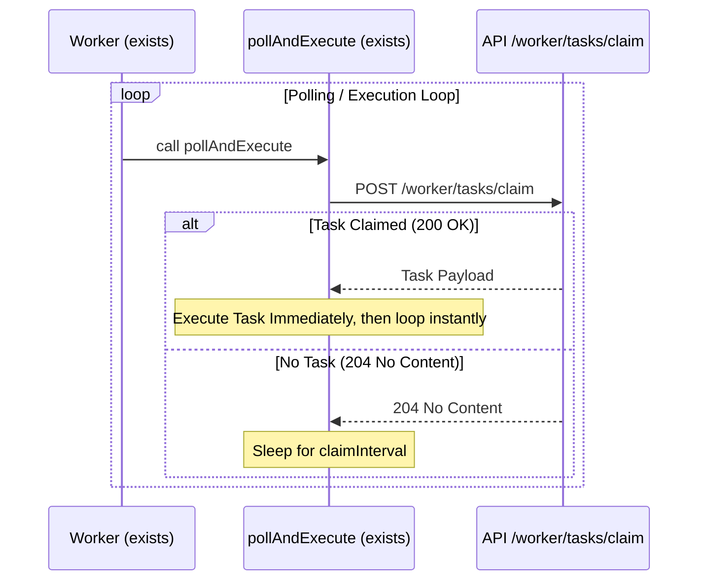
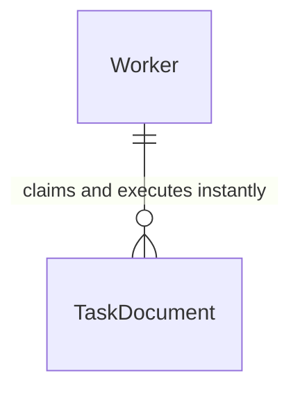

# Worker Instant Claim Polling

**Approved**: 2026-11-23 - user: "ok"

> Build this with **tlc-implement**. Every criterion becomes a check with a proof; nothing under the open questions is settled while building.

## Problem

Currently, the worker uses a fixed ticker (`claimInterval`) to poll for tasks. Even when tasks are present and executed, the worker waits for the interval timer between iterations, underutilizing processing capacity. When no tasks are available, it still polls periodically.

When this ships, the worker will poll continuously and immediately execute subsequent tasks when available, only waiting for `claimInterval` (exists) as a backoff spacer when no tasks are found (204 No Content).

## Shape

This modifies `Worker.Start` and `pollAndExecute` in `worker/worker.go`. Rules for polling behavior run in Go code reached by worker tests.

1. Worker starts and enters execution loop (`Worker.Start` exists in `worker/worker.go`).
2. Worker calls `pollAndExecute` (exists).
3. If task is claimed and executed (claimed = true), worker immediately requests the next task via `pollAndExecute` (exists) without waiting.
4. If no task is available (claimed = false / 204), worker sleeps for `claimInterval` (exists) before polling again.

**Changes underneath**

| Front | What changes |
| --- | --- |
| domain | `Worker.Start` polling loop logic |
| stored data | nothing to migrate |
| readers | worker task processing loop |

New: nothing. One-way constraints: none.

## Surface

None - nothing consumed outside

## Landing

| One-way door | Literal shape | Alternative rejected |
| --- | --- | --- |
| None | Continuous loop with 204-based backoff | Keeping fixed ticker interval (rejected because it delays processing queued tasks unnecessarily) |

- Nothing else in this change is hard to reverse

## Criteria

### S1: Instant task claim polling and execution (P1)

Worker immediately requests subsequent tasks when a task is executed, waiting `claimInterval` only on 204 No Content.

**Acceptance Criteria**

1. WHEN worker successfully claims and executes a task THEN the system SHALL immediately call `ClaimTask` again without waiting for `claimInterval`.
2. WHEN `ClaimTask` returns no content (204 No Content) THEN the system SHALL wait for the configured `claimInterval` duration before polling for the next task.
3. WHEN worker is waiting for `claimInterval` after a 204 response THEN the system SHALL respect context cancellation (shutdown signal) immediately.
4. WHEN an error occurs during task claim THEN the system SHALL handle the error and wait for `claimInterval` before retrying.

## Out of scope

| Excluded | Why |
| --- | --- |
| Multi-threaded concurrent task workers | Out of scope; single sequential worker loop processing tasks instantly |

## Assumptions

| Assumption | Chosen default | Rationale | Confirmed? |
| --- | --- | --- | --- |
| Immediate claim after task completion | True | Maximizes throughput when tasks are queued | y |

**Open questions:** none - all resolved or logged above.

## Differences from the source

None - no binding source provided.

## Sources

- User prompt - binding - specifies that `claimInterval` should only be used as a spacer when `claim` returns 204, and successful tasks should be processed immediately one after another.
