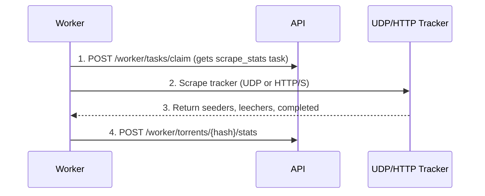
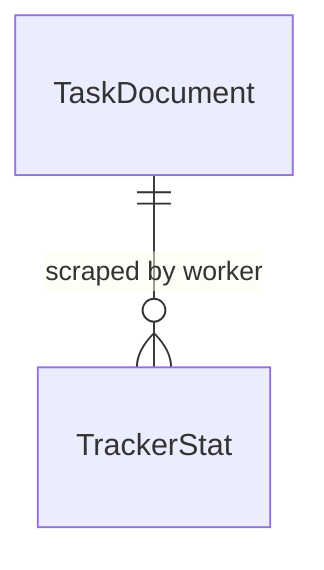

# Worker Scrape Stats & Info Hash Normalization

**Approved**: 2026-11-09 - user: "o torf é utilizado para extrair o info hash de um magnet link, no nosso caso nao precisamos extrair de um magnet link, o usuario ja vai mandar o info hash. então nao sera necessario utilizar o torf nesse caso. considere o trecho do codigo partindo da linha 20. ate a 32."

> Build this with **tlc-implement**. Every criterion becomes a check with a proof; nothing under the open questions is settled while building.

## Problem

Currently, `scrape_stats` tasks in the Go worker are stubs that fail tasks immediately, and info hashes received from APIs lack standardized validation and normalization to 40-character lowercase hex strings (handling 40-char hex and 32-char base32 formats). Additionally, workers need to scrape UDP and HTTP(S) trackers to collect seeder and leecher statistics and submit them to the API.

When this ships, info hashes across Python API schemas are automatically validated and normalized to 40-character lowercase hex, and the Go worker successfully executes `scrape_stats` tasks by scraping UDP and HTTP(S) trackers and submitting stats via `POST /worker/torrents/{hash}/stats`.

## Shape

1. **Python Schemas**: Add a reusable Pydantic field validator for info hashes that handles raw 40-char hex and 32-char base32 formats (normalizing via base32 decoding and hex validation without external parsers), normalizing them to 40-character lowercase hex.
2. **Go Worker**: Implement UDP scrape/announce and HTTP(S) scrape/announce logic, connecting to trackers, parsing responses, and reporting results back via API.

**Changes underneath**

| Front | What changes |
| --- | --- |
| domain / schemas | Pydantic info hash validator and normalizer across input schemas. |
| worker | Go `scrape_stats` handler implementing UDP and HTTP scraper protocol and API reporting. |

New: nothing - modifies existing schemas and worker task handlers.

## Surface

| Component | In | Out | Status | Who |
| --- | --- | --- | --- | --- |
| API Schemas | input payload | normalized response | `200`, `401`, `403`, `404`, `422` | API Clients |
| Go Worker | `scrape_stats` task | tracker stats submission | `200`, `401`, `422`, `500` | Go Worker |

## Landing

| One-way door | Literal shape | Alternative rejected |
| --- | --- | --- |
| None | Standardized 40-char hex normalization in Pydantic schemas and native UDP/HTTP scraper in Go worker | Keeping raw unvalidated info hashes or python-only worker |

- Nothing else in this change is hard to reverse

## Criteria

### S1: Info Hash Validation & Normalization in Schemas (P1)

As an API client, I want any submitted info hash (whether raw 40-char hex or 32-char base32) to be automatically validated and normalized to a 40-character lowercase hex string by Pydantic schemas.

**Acceptance Criteria**

1. WHEN an input schema receives a valid 40-character hex info hash (case-insensitive) THEN the system SHALL normalize it to 40-character lowercase hex.
2. WHEN an input schema receives a valid 32-character base32 info hash THEN the system SHALL decode and normalize it to 40-character lowercase hex.
3. WHEN an input schema receives an invalid info hash format THEN the system SHALL raise a validation error (HTTP 422).

### S2: Worker Tracker Scraping & Stats Submission (P1)

As a system operator, I want the Go worker to successfully scrape UDP and HTTP(S) trackers for `scrape_stats` tasks and submit the resulting statistics to the API.

**Acceptance Criteria**

1. WHEN the Go worker claims a `scrape_stats` task with a UDP tracker URL THEN the system SHALL execute a UDP connection request and scrape/announce request, parse seeders and leechers, and submit them via `POST /worker/torrents/{hash}/stats`.
2. WHEN the Go worker claims a `scrape_stats` task with an HTTP(S) tracker URL THEN the system SHALL execute an HTTP(S) scrape/announce request, parse bencoded seeder and leecher metrics, and submit them via `POST /worker/torrents/{hash}/stats`.
3. WHEN a tracker scrape fails due to network or protocol errors THEN the system SHALL report task failure to the API via `POST /worker/tasks/{task_id}/fail`.

## Out of scope

| Excluded | Why |
| --- | --- |
| Distributed consensus among multiple workers | Lease mechanisms and task locking handle distribution |

## Assumptions

| Assumption | Chosen default | Rationale | Confirmed? |
| --- | --- | --- | --- |
| Info hash formats | 40-char hex and 32-char base32 handled via base32 decoding / hex validation | Matches user instruction and betor's base32/hex normalization logic | y |

**Open questions:** none - all resolved or logged above.

## Differences from the source

None - the product matches the user requirements.

## Sources

- User prompt - binding - info hash validation and normalization to 40 chars in schemas (referencing betorbr/betor lines 20-32), and worker tracker scraping for UDP and HTTP trackers (referencing tboy1337/scrapeer-py).
