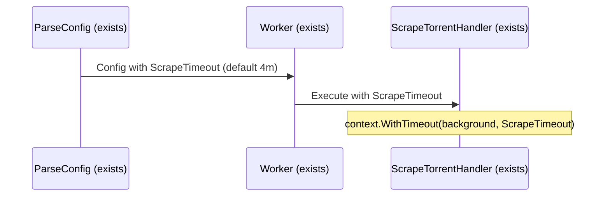

# Worker Scrape Timeout Configuration

**Approved**: 2026-11-23 - user: "ok"

> Build this with **tlc-implement**. Every criterion becomes a check with a proof; nothing under the open questions is settled while building.

## Problem

Workers currently use a hardcoded timeout of 45 seconds when waiting for torrent metadata during `scrape_torrent` tasks. For some torrents, peer discovery and connecting to trackers takes longer than 45 seconds, resulting in persistent timeouts even when known trackers are provided.

When this ships, the metadata scrape timeout will be configurable with a default of 4 minutes (240 seconds) - safely within the 5-minute task lease window - via environment variables or command-line flags.

## Shape

This reuses the worker configuration parser (`ParseConfig` exists in `worker/config.go`) and scrape torrent handler (`ScrapeTorrentHandler` exists in `worker/tasks/scrape_torrent.go`). Rules for timeout configuration run in Go code reached by worker tests.

1. Worker startup parses configuration via `ParseConfig` (exists) supporting `--scrape-timeout` flag or `TORRENT_STATS_SCRAPE_TIMEOUT` env var (default 4m).
2. `Worker` (exists) passes configured timeout to `ScrapeTorrentHandler`.
3. `ScrapeTorrentHandler` (`worker/tasks/scrape_torrent.go` exists) uses the configured timeout duration for the `context.WithTimeout` waiting for `t.GotInfo()`.

**Changes underneath**

| Front | What changes |
| --- | --- |
| domain | `Config` struct now holds `ScrapeTimeout time.Duration` |
| stored data | nothing to migrate |
| readers | worker scrape_torrent execution |

New: `ScrapeTimeout` configuration parameter in `Config`. One-way constraints: none.

## Surface

None - nothing consumed outside

## Landing

| One-way door | Literal shape | Alternative rejected |
| --- | --- | --- |
| `ScrapeTimeout` config option | `ScrapeTimeout time.Duration` (default `4 * time.Minute`) | Hardcoding a fixed larger timeout (rejected because different environments or torrent sizes may require tuning) |

- Nothing else in this change is hard to reverse

## Criteria

### S1: Configurable scrape metadata timeout in worker (P1)

Worker configuration parses scrape timeout and applies it to metadata fetching context.

**Acceptance Criteria**

1. WHEN worker is started without scrape timeout configuration THEN the system SHALL default `ScrapeTimeout` to 4 minutes (`240s`).
2. WHEN worker is configured with `--scrape-timeout <duration>` flag or `TORRENT_STATS_SCRAPE_TIMEOUT` environment variable THEN the system SHALL parse and use the specified duration.
3. WHEN `ScrapeTorrentHandler` waits for torrent metadata THEN the system SHALL use the configured `ScrapeTimeout` duration for the context timeout.
4. IF an invalid duration format is provided to `--scrape-timeout` or `TORRENT_STATS_SCRAPE_TIMEOUT` THEN worker startup SHALL return an error.

## Out of scope

| Excluded | Why |
| --- | --- |
| Dynamic per-torrent timeout overrides | Out of scope; global worker scrape timeout is sufficient |

## Assumptions

| Assumption | Chosen default | Rationale | Confirmed? |
| --- | --- | --- | --- |
| 4 minutes is appropriate default | 4m | Fits comfortably within the 5-minute task lease window while allowing ample time for slow trackers/DHT | y |

**Open questions:** none - all resolved or logged above.

## Differences from the source

None - no binding source provided.

## Sources

- User prompt - binding - specifies making scrape metadata timeout configurable with a default of 4 minutes.
