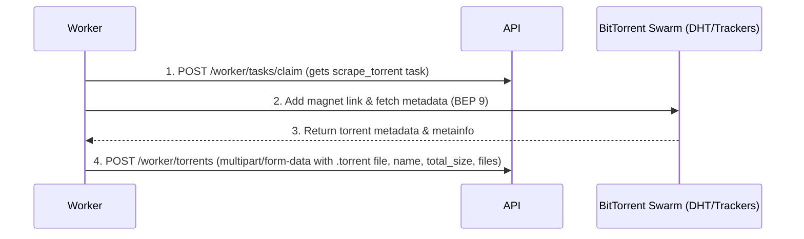
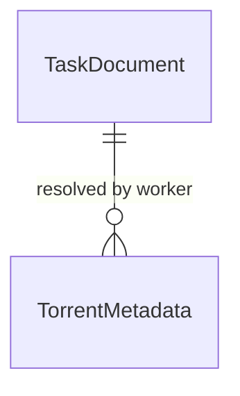

# Worker Scrape Torrent & Metadata Resolution

**Approved**: 2026-11-20 - user: "aprovado"

> Build this with **tlc-implement**. Every criterion becomes a check with a proof; nothing under the open questions is settled while building.

## Problem

Currently, `scrape_torrent` tasks in the Go worker are execution stubs that immediately fail tasks with "scrape_torrent task execution not yet implemented". Workers lack any capability to resolve info hashes into `.torrent` files and torrent metadata (name, file tree, total size) from the BitTorrent network (DHT, trackers, and peers).

When this ships, the Go worker successfully processes `scrape_torrent` tasks by resolving magnet links using `github.com/anacrolix/torrent`, extracting torrent metadata and `.torrent` file bytes, and uploading them to the API via `POST /worker/torrents`.

## Shape

1. **Go Worker (`scrape_torrent` module)**: Reuses `github.com/anacrolix/torrent` client to add magnet links (`magnet:?xt=urn:btih:<info_hash>`), wait for metadata resolution (BEP 9 / DHT / trackers), extract `.torrent` metainfo bytes, file tree, name, and total size, and submit via multipart POST request to `POST /worker/torrents`.

**Changes underneath**

| Front | What changes |
| --- | --- |
| worker | Go `scrape_torrent` handler implementing BitTorrent metadata client and API upload. |
| worker/go.mod | Adds `github.com/anacrolix/torrent` and dependencies. |

New: nothing - modifies worker task execution and storage client calls.

## Surface

| Route / Task | In | Out | Status | Who |
| --- | --- | --- | --- | --- |
| Go Worker `scrape_torrent` task | `scrape_torrent` task payload | `POST /worker/torrents` or `POST /worker/tasks/{id}/fail` | `200`, `201`, `401`, `422`, `500` | Go Worker |

## Landing

| One-way door | Literal shape | Alternative rejected |
| --- | --- | --- |
| `github.com/anacrolix/torrent` dependency | Added to `worker/go.mod` for BitTorrent client operations | Custom pure-Go wire protocol implementation (rejected due to excessive complexity and protocol edge cases) |

- Nothing else in this change is hard to reverse

## Criteria

### S1: Go Worker Torrent Metadata Scraping & Upload & File Path String (P1)

As a system operator, I want the Go worker to successfully resolve `scrape_torrent` tasks by fetching torrent metadata from the BitTorrent network and uploading the `.torrent` file and file tree (with file paths as strings) to the API.

**Acceptance Criteria**

1. WHEN the Go worker claims a `scrape_torrent` task THEN the system SHALL construct a magnet link from the info hash, add it to the BitTorrent client, and wait for metadata resolution.
2. WHEN torrent metadata is successfully resolved THEN the system SHALL extract the torrent name, total size, file tree (with each file path formatted as a single string), and `.torrent` file bytes, and upload them to the API via `POST /worker/torrents` with `info_hash`, `name`, `total_size`, `torrent_file`, and `files`.
3. IF torrent metadata resolution times out or fails due to network/swarm issues THEN the system SHALL report task failure to the API via `POST /worker/tasks/{task_id}/fail`.
4. WHEN a client requests torrent details via `GET /torrents/{hash}` THEN the system SHALL return each file's `path` as a string (`str`) rather than a list of strings.

## Out of scope

| Excluded | Why |
| --- | --- |
| Seeding or downloading actual content pieces | Only metadata (.torrent file and file tree structure) is required |

## Assumptions

| Assumption | Chosen default | Rationale | Confirmed? |
| --- | --- | --- | --- |
| BitTorrent library | `github.com/anacrolix/torrent` | Industry-standard Go library supporting DHT, trackers, and metadata extension | y |

**Open questions:** none - all resolved or logged above.

## Differences from the source

None - the product matches the user requirements.

## Sources

- User prompt - binding - implement `scrape_torrent` task in the Go worker referencing libtorrent / betor metadata resolution.
