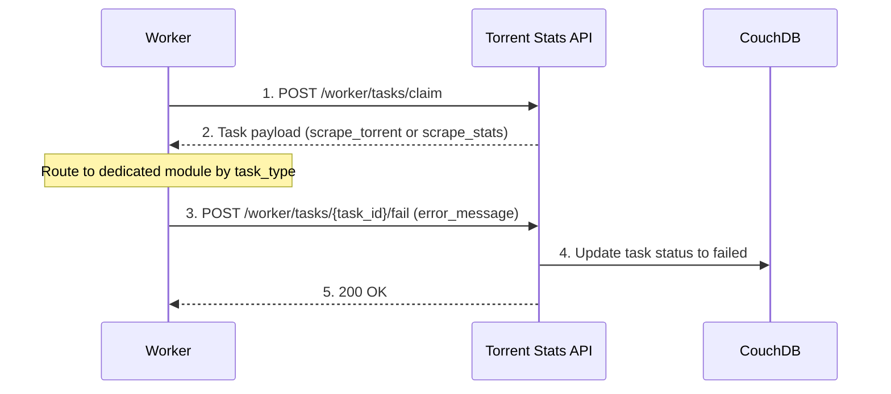
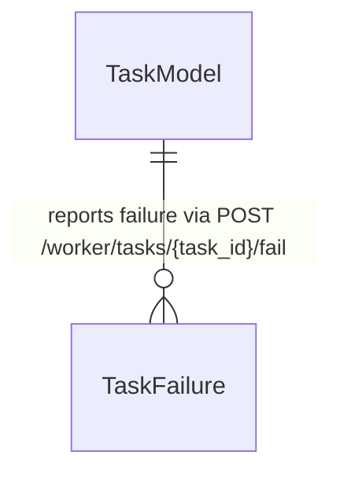

# Worker Task Failure Signaling and Routing

**Approved**: 2026-11-07 - user: "ok"

> Build this with **tlc-implement**. Every criterion becomes a check with a proof; nothing under the open questions is settled while building.

## Problem

Remote workers currently lack a mechanism to report task failures back to the API when a task execution encounters a problem, and the API lacks an endpoint (`POST /worker/tasks/{task_id}/fail`) to ingest task failure notifications. Additionally, the Go worker lacks task routing based on `task_type` (`scrape_torrent` and `scrape_stats`) with dedicated modules for each type.

When this ships, workers will route claimed tasks to dedicated modules (`scrape_torrent` and `scrape_stats`) based on their `task_type`, invoke the unreserved implementation stubs which report failures via `POST /worker/tasks/{task_id}/fail`, and the API will successfully ingest and record task failure status.

## Shape

This reuses existing task models (`TaskModel`), repository methods, and worker authentication middleware in the Python API, and extends the Go worker binary (`worker/`) with modular task routing and failure reporting HTTP client methods.

1. Worker claims task (`POST /worker/tasks/claim`) -> checks `task_type` -> dispatches to `scrape_torrent` or `scrape_stats` module (new).
2. Task module execution stub -> determines task is not yet implemented -> constructs failure request with `error_message` -> calls API `POST /worker/tasks/{task_id}/fail` (door 1) with `X-Worker-Key` header.
3. API `POST /worker/tasks/{task_id}/fail` -> validates `X-Worker-Key` -> updates task status to failed in CouchDB (exists).

**Changes underneath**

| Front | What changes |
| --- | --- |
| domain | New API endpoint for task failure reporting (`POST /worker/tasks/{task_id}/fail`), new Go worker modules for `scrape_torrent` and `scrape_stats` tasks |
| stored data | Task status updated to failed upon failure notification |
| readers | Remote Workers and API controllers |

New: API task failure endpoint and Go worker task routing modules. One-way constraints: none.

## Surface

| Route | In | Out | Status | Who |
| --- | --- | --- | --- | --- |
| `POST /worker/tasks/{task_id}/fail` | Header `X-Worker-Key`, JSON body `{"error_message": "..."}` | success confirmation | `200 OK`, `400 Bad Request`, `401 Unauthorized`, `404 Not Found` | Remote Workers |

## Landing

| One-way door | Literal shape | Alternative rejected |
| --- | --- | --- |
| 1. Task Failure Endpoint Contract | `POST /worker/tasks/{task_id}/fail` accepting `error_message` body with `X-Worker-Key` auth | Generic error log without API reporting (rejected due to lack of task visibility and lease management on failure) |

- Nothing else in this change is hard to reverse

## Criteria

### S1: API Task Failure Ingest Endpoint (P1)

As a remote worker, I want to notify the API when a task fails via `POST /worker/tasks/{task_id}/fail`.

**Acceptance Criteria**

1. WHEN a remote worker sends `POST /worker/tasks/{task_id}/fail` with a valid `X-Worker-Key` header and JSON body `{"error_message": "not implemented"}` THEN the API SHALL update the task state to failed and return `200 OK`.
2. IF a request to `POST /worker/tasks/{task_id}/fail` lacks a valid `X-Worker-Key` header THEN the system SHALL return `401 Unauthorized`.
3. IF `task_id` does not exist in CouchDB THEN the system SHALL return `404 Not Found`.

### S2: Go Worker Task Routing & Failure Reporting (P2)

As a remote worker operator, I want the worker to route tasks by `task_type` (`scrape_torrent` and `scrape_stats`) to dedicated modules, and report un-implemented task failures to the API.

**Acceptance Criteria**

1. WHEN the worker claims a task with `task_type` equal to `scrape_torrent` THEN the worker SHALL route the task to the `scrape_torrent` module.
2. WHEN the worker claims a task with `task_type` equal to `scrape_stats` THEN the worker SHALL route the task to the `scrape_stats` module.
3. WHEN a worker task module executes its un-implemented stub THEN it SHALL send `POST /worker/tasks/{task_id}/fail` to the API with an error message stating that it has not been implemented yet, and continue running.

## Out of scope

| Excluded | Why |
| --- | --- |
| Full implementation of `scrape_torrent` and `scrape_stats` task execution logic | Scheduled for subsequent feature iterations |

## Assumptions

| Assumption | Chosen default | Rationale | Confirmed? |
| --- | --- | --- | --- |
| Failure payload body format | JSON `{"error_message": "..."}` | Clean, standard JSON body | y |

**Open questions:** none - all resolved or logged above.

## Differences from the source

None - the product matches the user requirements.

## Sources

- User prompt - binding - task failure API endpoint taking only error_message, worker task routing by task_type (`scrape_torrent` and `scrape_stats`) into dedicated modules, worker calling task failure endpoint with not implemented message.
