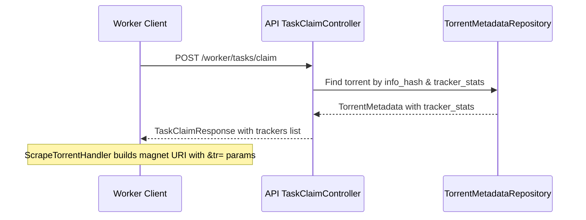
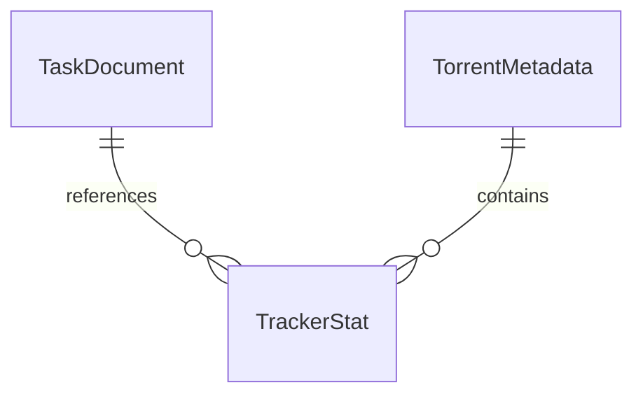

# Worker Torrent Trackers

**Approved**: 2026-11-23 - user: "ok"

> Build this with **tlc-implement**. Every criterion becomes a check with a proof; nothing under the open questions is settled while building.

## Problem

When workers claim a `scrape_torrent` task, they currently construct a basic magnet link with only the `xt=urn:btih:` parameter and rely solely on the DHT mesh to discover peers and metadata. If DHT discovery fails or is slow, torrents are often not found, leading to timeouts and task failures. Furthermore, the API does not provide the accumulated list of known trackers for that torrent from `torrent-stats` during task claim.

When this ships, workers claiming a `scrape_torrent` task will receive the full list of known trackers for that torrent from the API and include them in the magnet link, enabling direct tracker queries and improving peer discovery.

## Shape

This reuses the existing task claim controller, repository layer, and worker HTTP client. Rules for task claim response and worker magnet construction run in Python (API) and Go (Worker) layers reached by test suites.

1. Worker requests claim -> `TaskClaimController` (exists) queries task repository and `TorrentMetadataRepository` (exists) for known trackers.
2. `TaskClaimController` (exists) populates `trackers` list in `TaskClaimResponse` schema (door 1).
3. Worker client (`worker/client.go` exists) decodes `trackers` in `Task` response struct.
4. `ScrapeTorrentHandler` (`worker/tasks/scrape_torrent.go` exists) builds magnet URI with `&tr=` parameters for each tracker and adds it to the torrent client.

**Changes underneath**

| Front | What changes |
| --- | --- |
| domain | `TaskClaimResponse` now includes `trackers` field |
| stored data | nothing to migrate |
| readers | worker scrape_torrent execution |

New: `trackers` field in `TaskClaimResponse` schema and `Task` struct. One-way constraints: none.

## Surface

| Route | In | Out | Status | Who |
| --- | --- | --- | --- | --- |
| `POST /worker/tasks/claim` | X-Worker-Key header | TaskClaimResponse (task_id, info_hash, task_type, tracker_url, updated_at, lease_expires_at, trackers) | `200` (success with task), `204` (no task), `401` (unauthorized) | Worker with valid X-Worker-Key |

## Landing

| One-way door | Literal shape | Alternative rejected |
| --- | --- | --- |
| `trackers` field in `TaskClaimResponse` | `trackers: list[str] = Field(default_factory=list)` | Embedding trackers inside task document (rejected because trackers belong to TorrentMetadata / tracker stats) |

- Nothing else in this change is hard to reverse

## Criteria

### S1: Worker receives and uses torrent trackers during scrape (P1)

API returns torrent trackers on task claim and worker uses them in magnet link.

**Acceptance Criteria**

1. WHEN worker calls `POST /worker/tasks/claim` for a `scrape_torrent` task and the torrent has associated tracker stats in the database THEN the system SHALL return a `TaskClaimResponse` containing the list of tracker URLs in the `trackers` field.
2. WHEN `TaskClaimResponse` contains a list of tracker URLs THEN the worker `ScrapeTorrentHandler` SHALL construct the magnet link including each tracker as a `tr` query parameter (`&tr=<url>`).
3. IF a torrent has no associated tracker stats in the database THEN `TaskClaimResponse` SHALL return an empty `trackers` list (`[]`).
4. IF task type is `scrape_stats` then `TaskClaimResponse` SHALL return the specific `tracker_url` and an empty or relevant `trackers` list.

## Out of scope

| Excluded | Why |
| --- | --- |
| Dynamic tracker scraping from external trackers list | Out of scope; only existing trackers in `torrent-stats` are used |

## Assumptions

| Assumption | Chosen default | Rationale | Confirmed? |
| --- | --- | --- | --- |
| Tracker URLs in `TorrentMetadata.tracker_stats` are valid HTTP/UDP tracker URIs | Use them as-is in magnet `tr=` parameters | Already validated when submitted via tracker stats | y |

**Open questions:** none - all resolved or logged above.

## Differences from the source

None - no binding source provided.

## Sources

- User prompt - binding - specifies returning current list of trackers on scrape torrent task claim and adding them to magnet link in worker.
